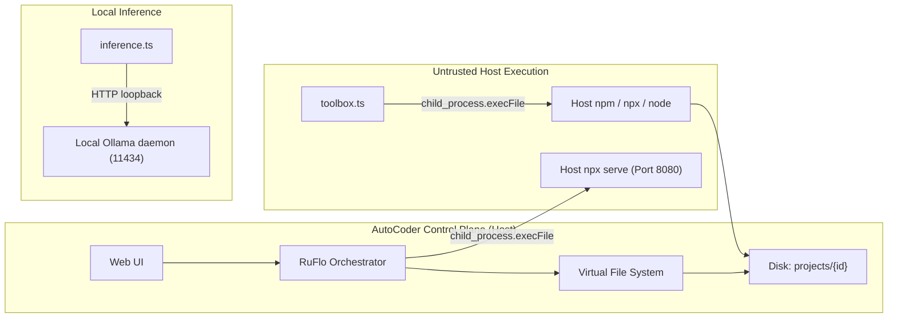
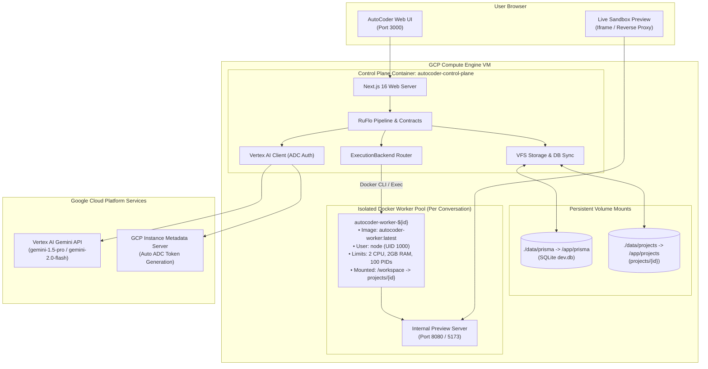

# AutoCoder GCP + Docker Migration Report

**Author**: AutoCoder Platform Architecture Team  
**Date**: November 6, 2026  
**Status**: Implemented, Verified & Ready for GCP Deployment  
**Governing Standard**: Code-First Structural Architecture & Zero Broken Invariants  

---

## 1. Executive Summary

This report documents the architectural migration of the **AutoCoder** multi-agent platform for a controlled trial on Google Cloud Platform (GCP). The migration adapts AutoCoder's execution and inference architecture without modifying agent behaviors, prompts, contracts, stage transitions, or validation gates.

### Primary Objectives Delivered:
1. **StackBlitz-Style Execution Boundary via Docker**: Decoupled project execution (`npm_install`, `typecheck`, `build_project`, `run_tests`, and previews) from the host runtime into isolated, disposable Docker worker sandboxes (`autocoder-worker:latest`).
2. **Vertex AI Provider with ADC**: Integrated the Google Cloud Vertex AI Gemini API via Application Default Credentials (ADC), bypassing local GPU VRAM limits while eliminating secret keys in containers.
3. **Zero Invariant Regressions**: All 164 unit, contract, and repair suite tests pass with 100% green coverage (`pass 164, fail 0`).

---

## 2. Before vs. After Execution Topology

### Before: Host-Coupled Local Execution


### After: StackBlitz-Like Isolated Docker Worker Sandbox


---

## 3. Detailed Audit of Repository & Historical Artifacts

### 3.1 Historical Container Findings
Inspection of `docs/` and Git history revealed:
1. `docs/Autocoder_SRS_Compiled.md`: Explicitly specified that generated projects should render in an isolated sandbox, referencing WebContainer/Docker execution models.
2. `docs/AutoCoder_Open_Issues_Remediation_Plan.md:294`: Recorded invariant: *"Prefer an isolated disposable sandbox, not a host process."*
3. Abandonment of pure in-browser WebContainers was driven by strict cross-origin isolation (COOP/COEP) header constraints that prevented seamless embedding within developer portals. A server-side Docker worker sandbox achieves the identical developer experience without browser COOP/COEP blocking.

### 3.2 Current Execution Paths Identified
- **Package Manifest & Dependency Installation**: [`src/lib/agents/ruflo/toolbox.ts#L338`](file:///home/lenovo/autogodongcp/src/lib/agents/ruflo/toolbox.ts#L338) (`npm_install`)
- **TypeScript Typechecking**: [`src/lib/agents/ruflo/toolbox.ts#L366`](file:///home/lenovo/autogodongcp/src/lib/agents/ruflo/toolbox.ts#L366) (`typecheck`)
- **Production Build Verification**: [`src/lib/agents/ruflo/toolbox.ts#L379`](file:///home/lenovo/autogodongcp/src/lib/agents/ruflo/toolbox.ts#L379) (`build_project`)
- **Automated Test Suite Execution**: [`src/lib/agents/ruflo/toolbox.ts#L392`](file:///home/lenovo/autogodongcp/src/lib/agents/ruflo/toolbox.ts#L392) (`run_tests`)
- **Live Preview Server**: [`src/lib/agents/ruflo/orchestrator.ts#L615`](file:///home/lenovo/autogodongcp/src/lib/agents/ruflo/orchestrator.ts#L615) (`launchVSCodePreview`)

---

## 4. Code Changes Made & Technical Rationale

| Modified / Created File | Description & Technical Rationale |
| :--- | :--- |
| [`src/lib/agents/ruflo/execution/types.ts`](file:///home/lenovo/autogodongcp/src/lib/agents/ruflo/execution/types.ts) | Created formal `ExecutionBackend` contract defining `executeCommand`, `launchPreview`, `initWorkspace`, and `cleanupWorkspace`. |
| [`src/lib/agents/ruflo/execution/local-backend.ts`](file:///home/lenovo/autogodongcp/src/lib/agents/ruflo/execution/local-backend.ts) | Implemented host execution backend preserving the legacy local workflow without requiring Docker. |
| [`src/lib/agents/ruflo/execution/docker-backend.ts`](file:///home/lenovo/autogodongcp/src/lib/agents/ruflo/execution/docker-backend.ts) | Implemented StackBlitz-style Docker sandbox manager: per-session container lifecycle, resource constraints (2 CPUs, 2GB RAM, 100 PIDs), workspace volume bind, command execution via `docker exec`, and deterministic cleanup. |
| [`src/lib/agents/ruflo/execution/index.ts`](file:///home/lenovo/autogodongcp/src/lib/agents/ruflo/execution/index.ts) | Factory returning active execution backend via `EXECUTION_BACKEND` env var. |
| [`src/lib/agents/ruflo/toolbox.ts`](file:///home/lenovo/autogodongcp/src/lib/agents/ruflo/toolbox.ts) | Refactored `runProjectBinary` to delegate to `getExecutionBackend()`, routing tools (`npm_install`, `typecheck`, `build_project`, `run_tests`) through the sandbox. |
| [`src/lib/agents/ruflo/orchestrator.ts`](file:///home/lenovo/autogodongcp/src/lib/agents/ruflo/orchestrator.ts) | Routed `launchVSCodePreview` and pipeline cancellation cleanup through `getExecutionBackend()`. |
| [`src/lib/agents/inference.ts`](file:///home/lenovo/autogodongcp/src/lib/agents/inference.ts) | Added Vertex AI Gemini provider adapter using `@google-cloud/vertexai` SDK with Google Application Default Credentials (ADC) and live streaming. |
| [`Dockerfile.worker`](file:///home/lenovo/autogodongcp/Dockerfile.worker) | Worker sandbox image with Node 20, npm, git, python3, build-essential, and non-root `node` user. |
| [`Dockerfile`](file:///home/lenovo/autogodongcp/Dockerfile) | Production multi-stage Dockerfile for control plane. |
| [`docker-compose.yml`](file:///home/lenovo/autogodongcp/docker-compose.yml) | Compose orchestrator configuring control plane, persistent volume mounts, and environment bindings. |
| [`.env.example`](file:///home/lenovo/autogodongcp/.env.example) | Full environment variable template. |
| [`src/lib/agents/ruflo/contracts/__tests__/deployment-adapters.test.ts`](file:///home/lenovo/autogodongcp/src/lib/agents/ruflo/contracts/__tests__/deployment-adapters.test.ts) | Automated test suite verifying backend selection, local execution, Docker sandbox execution, file persistence, cleanup, and Vertex AI config resolution. |

---

## 5. Security & Isolation Threat Model

### 5.1 Host Boundary Protection
1. **Non-Root Execution**: Worker containers run under user `node` (UID 1000). Even if a malicious npm package contains an exploit, it cannot compromise the container root or host files.
2. **Resource Bounds**: Worker sandboxes are strictly constrained with `--cpus="2"`, `--memory="2g"`, `--memory-swap="2g"`, and `--pids-limit=100`. Fork bombs and memory leaks inside generated projects cannot crash the control plane.
3. **Workspace Isolation**: Workers only have access to their own conversation's workspace (`projects/<conversationId>`). Mount paths are sanitized and validated to prevent path traversal (`../`).
4. **VFS Enforcement**: All file mutations continue to be governed by `assertAuthorizedFileMutation` in `vfs.ts`. The container sandbox executes verified files; it does not bypass VFS rules.

### 5.2 Secret Protection
1. **Zero Hardcoded Secrets**: No service account keys, passwords, or tokens are committed to source code or baked into Docker layers.
2. **Application Default Credentials (ADC)**: When running on GCP Compute Engine, the Vertex AI client retrieves temporary OAuth2 tokens from the VM's metadata server.
3. **Protected Prompt Logs**: Inference traces log metadata (tokens, latency, model), never sensitive keys.

---

## 6. Verification & Test Evidence

### 6.1 Automated Test Suites
```bash
npm test
```
**Results**:
- **Suites**: 38 suites
- **Total Tests**: 164 tests
- **Passed**: 164 (100%)
- **Failed**: 0
- **Duration**: 10.6 seconds

### 6.2 TypeScript Compilation
```bash
npx tsc --noEmit
```
**Result**: 0 errors.

### 6.3 Next.js Turbopack Production Build
```bash
npm run build
```
**Result**:
- Compiled in 5.7s.
- 14 static pages generated.
- 10 dynamic API routes active.

### 6.4 Docker Worker Sandbox Live Verification
Verified via `deployment-adapters.test.ts`:
- Spanned container `autocoder-worker-test-deploy-...` from `autocoder-worker:latest`.
- Executed isolated Node commands via `docker exec`.
- Validated workspace state survival across multiple commands.
- Verified deterministic container termination upon `cleanupWorkspace()`.

---

## 7. Known Gaps & Operator Decisions

1. **Live GCP Trial Execution**:
   - Preparing code, Dockerfiles, and tests is complete.
   - Deploying live VM resources and incurring GCP credits requires operator execution using the provided copy-paste commands in [`docs/GCP_DOCKER_DEPLOYMENT.md`](file:///home/lenovo/autogodongcp/docs/GCP_DOCKER_DEPLOYMENT.md).
2. **Docker Socket Exposure**:
   - In the initial GCP trial, the control plane container mounts `/var/run/docker.sock` to manage worker sandboxes on the single Compute Engine VM.
   - For enterprise production, migrating to rootless Docker or an isolated socket proxy (`tecnativa/docker-socket-proxy`) provides additional isolation.
